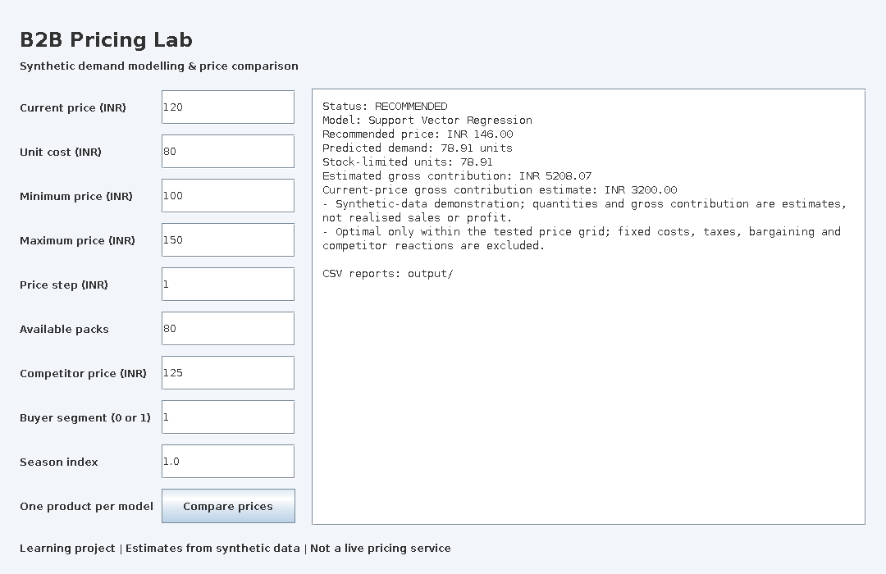

# B2B Dynamic Pricing Optimization Engine — Java Learning Edition

A runnable Java portfolio project by Mitanshu Jain. It predicts daily demand for one B2B product and compares candidate prices using estimated gross contribution.

**Data provenance:** all included observations are synthetic. They do not come from TCS, Goa Shipyard, or any real customer. Results are simulation results, not production profit improvements.

## How it works

1. Validate and sort the synthetic daily observations.
2. Split them chronologically into training (60%), validation (20%), and test (20%) periods.
3. Train a mean-demand baseline, Random Forest, and Support Vector Regression; select by validation RMSE.
4. Predict demand for each allowed price and apply the inventory limit.
5. Compare estimated gross contribution: `(price - unit cost) × min(predicted demand, available stock)`.

### Synthetic benchmark

| Model | Validation RMSE | Test MAE | Test RMSE |
| --- | --- | --- | --- |
| Mean baseline | 32.306 | 26.683 | 32.677 |
| Random Forest | 5.240 | 4.376 | 5.504 |
| Support Vector Regression | 3.665 | 3.058 | 3.861 |

Errors are in packs. These figures describe the bundled synthetic dataset and fixed configuration. Full run details are in [the verification record](docs/VERIFICATION.md).

## Included

- Java 17 source code and a Maven build.
- A deterministic generator and 720-row synthetic CSV.
- Strict CSV validation, training-only descriptive analysis, and chronological 60/20/20 splitting.
- Mean-demand baseline, Random Forest regression, and Gaussian-kernel Support Vector Regression.
- Model selection by validation RMSE; separate test MAE/RMSE.
- Constrained price-grid comparison, inventory caps, and explicit failure/no-recommendation outcomes.
- Console commands, a Java Swing desktop interface, report exports, and automated tests.
- A Maven wrapper and a GitHub Actions workflow.
- A practical build guide and a numbered source walkthrough.
